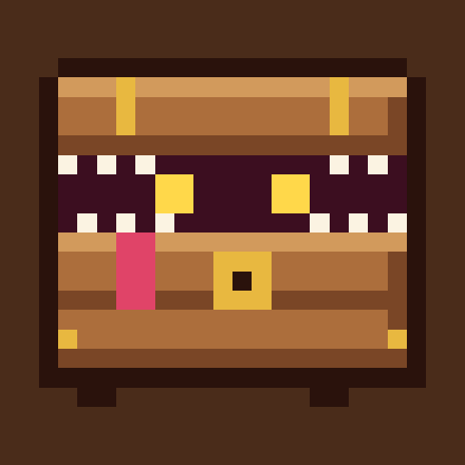
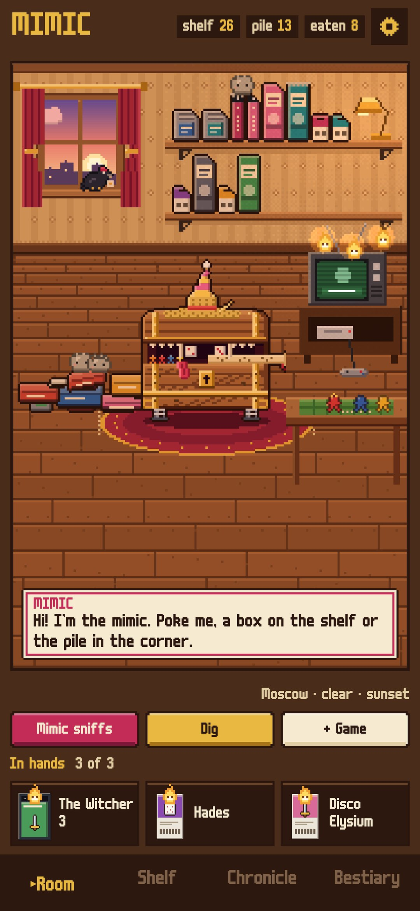
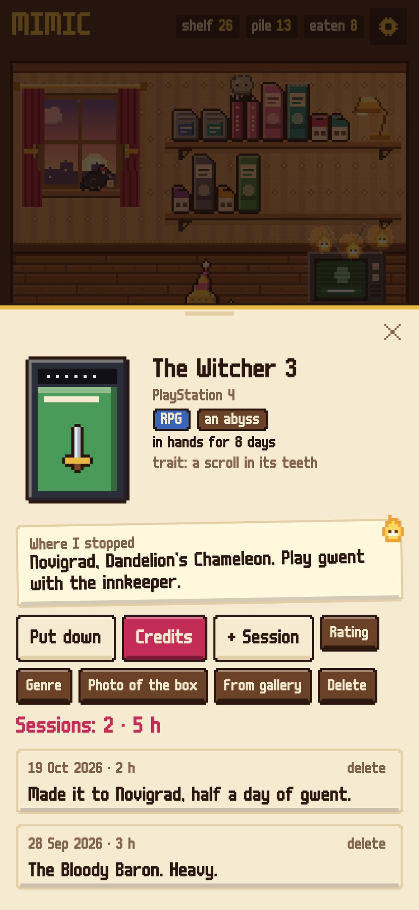
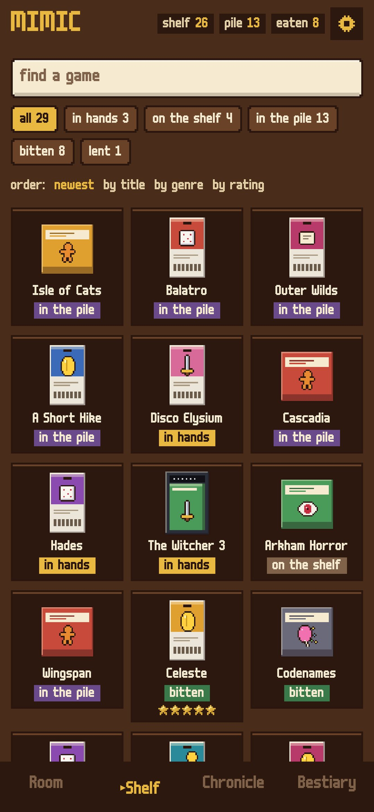
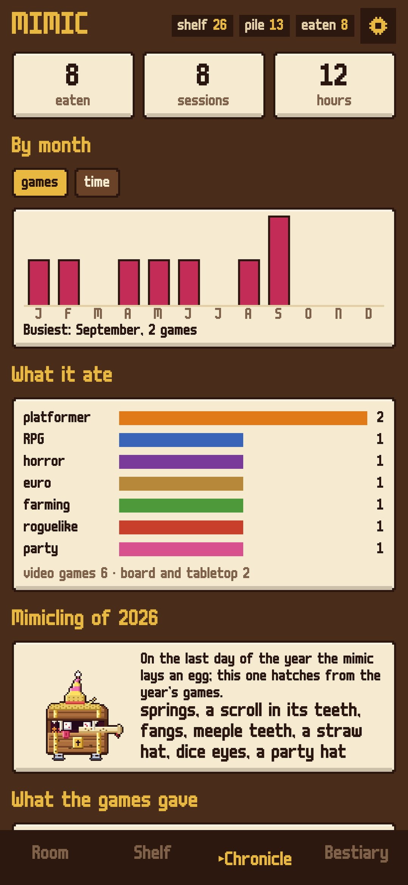
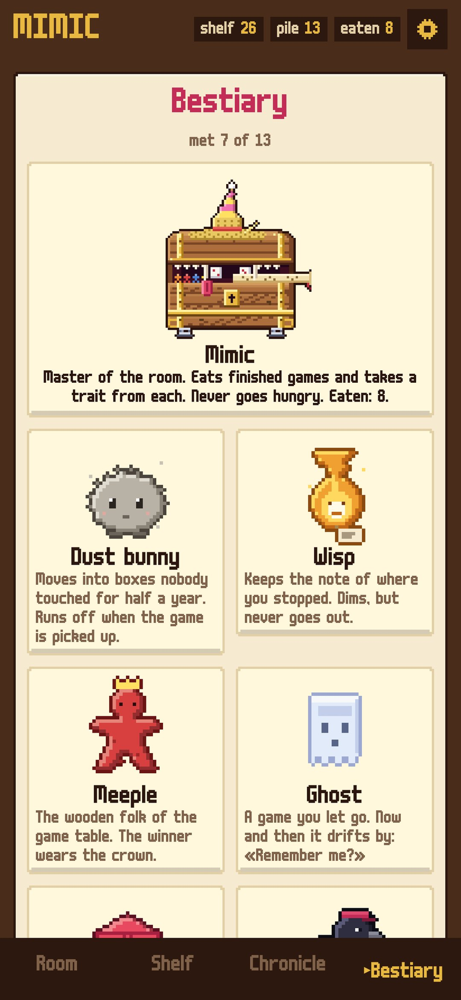

# Mimic

### A game shelf with a chest that eats what you finish

*Video games, board games and tabletop RPGs on one shelf in a pixel room. What you bought and never opened lies in a pile in the corner, and that's fine. Finish a game, roll the credits and feed it to the mimic: from every genre it takes a trait, and over the years it turns into a portrait of your taste. Free, no ads, no account.*

**English** · [Русский](README.ru.md) · [Changelog](CHANGELOG.md)

    

**[Download the APK](https://github.com/bigdevwhale/mimic/releases/latest/download/Mimic.apk)** · Android 9+

---

## How it works

1. **The room.** Shelves of boxes (cartridges, discs, board game boxes, key cards), a TV, a table with meeples, and the pile of unopened games in the corner. Everything in it can be tapped.
2. **Adding a game.** Search Wikidata and Wikipedia for video games, board games or tabletop RPGs: the year, the maker, the players and the cover come in, and the mimic redraws the cover in pixels. Or snap the box with the phone's camera, or type it in.
3. **Genres.** The popular genres for each kind (28 for video games, 21 for board games, 14 for RPGs), plus your own genres and subgenres with a colour and a trait.
4. **In hands, three at most.** A wisp lights over the TV for each. Put a game down with a note on where you stopped; when you come back, the wisp reads it to you.
5. **Sessions.** How long you played, a few words, screenshots from the gallery or a photo from the camera.
6. **The credits.** One line, what the game gave you, stars and a short review, then the mimic eats it. The box goes back to the shelf with a bite out of it, and the genre grows a trait: fangs, a straw hat, dice eyes, meeple teeth, springs.
7. **When you can't choose.** "Mimic sniffs" asks how much time there is, who's playing and what there's energy for, and pulls three boxes from the pile; a die picks among them. "Dig" brings up the oldest box from the bottom: half an hour, or let it go as a ghost.
8. **Lending.** The crow carries a box to a friend and sits on the sill till it comes back.
9. **The chronicle.** Games and hours by month, what the mimic ate, ratings and the game of the year, how long a box waits in the pile.
10. **The window.** The real sunrise, sunset and weather of your town: rain, snow, fog, a storm with lightning; the lamp and the TV light the room at night.

## Under the hood

- Kotlin, Jetpack Compose, Room, DataStore. Everything stays on the phone; the internet is only for the catalogue search and the weather (Open-Meteo, MET Norway as a fallback).
- The room, the mimic, its traits and the creatures are drawn in code (`ui/art`).
- `./gradlew assembleDebug -Pdemo` builds a demo with a lived-in room; `./gradlew testDebugUnitTest -Prender --tests '*RenderScreens*'` draws every screen to `app/build/art`, and `python tools/shots.py` turns them into these screenshots.

## License

MIT. Font: m6x11 by Daniel Linssen, with Cyrillic by Natto Games.
