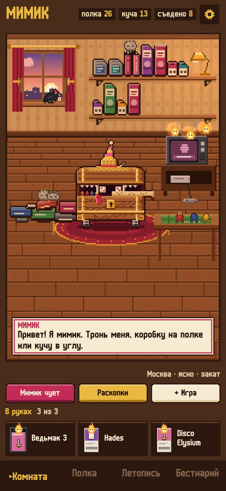
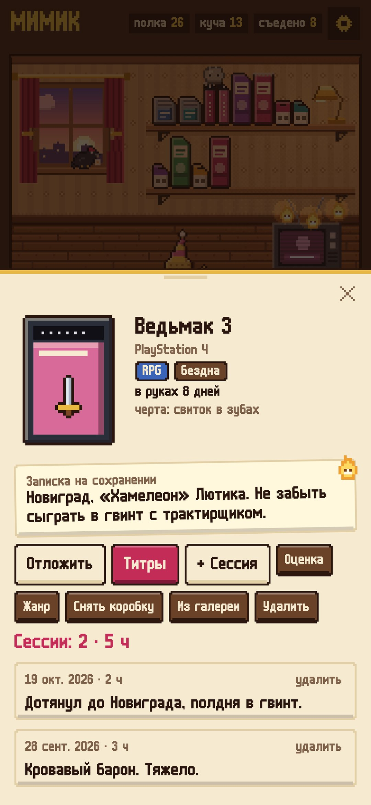
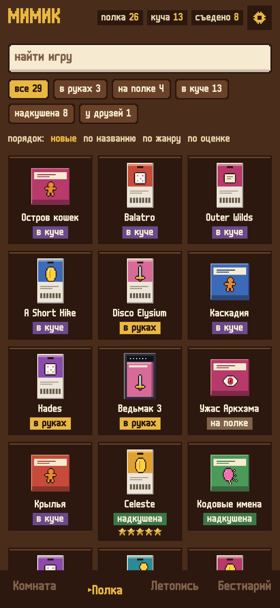
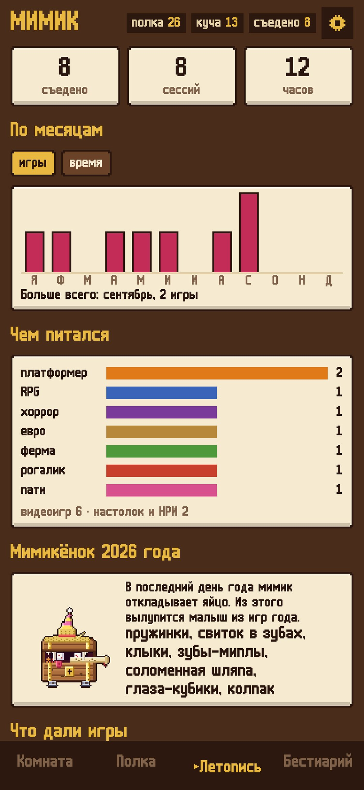
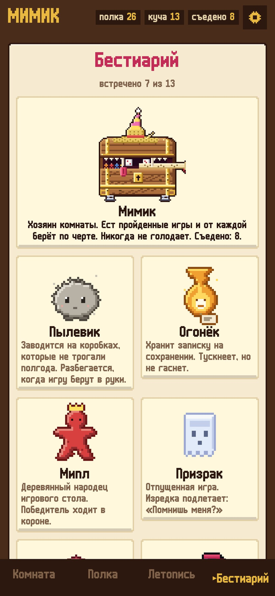

# Мимик

### Полка игр и сундук, который ест пройденные

*Видеоигры, настолки и НРИ на одной полке в пиксельной комнате. Что куплено и не начато, лежит кучей в углу, и это нормально. Прошёл игру — запусти титры и отдай её мимику: от каждого жанра он берёт черту и с годами становится портретом твоего вкуса. Бесплатно, без рекламы и регистрации.*

[English](README.md) · **Русский** · [Изменения](CHANGELOG.md)

    

**[Скачать APK](https://github.com/bigdevwhale/mimic/releases/latest/download/Mimic.apk)** · Android 9+

---

## Как это устроено

1. **Комната.** Полки с коробками (картриджи, диски, коробки настолок, ключ-карты), телевизор, стол с миплами и куча нераспечатанного в углу. Всё в ней можно трогать.
2. **Новая игра.** Поиск по Викиданным и Википедии для видеоигр, настолок и НРИ: приходят год, автор, число игроков и обложка, а мимик перерисовывает её в пиксели. Можно сфотографировать коробку камерой телефона или вписать игру вручную.
3. **Жанры.** Популярные жанры для каждой категории (28 для видеоигр, 21 для настолок, 14 для НРИ), а ещё свои жанры и поджанры с цветом и чертой.
4. **В руках — не больше трёх.** Над телевизором загорается огонёк для каждой. Откладываешь игру — пишешь, где остановился, а когда вернёшься, огонёк прочитает записку.
5. **Сессии.** Сколько играли, пара слов, скриншоты из галереи или снимок с камеры.
6. **Титры.** Одна строка, что дала игра, звёзды и короткий отзыв — и мимик её съедает. Коробка возвращается на полку надкушенной, а жанр даёт черту: клыки, соломенную шляпу, глаза-кубики, зубы-миплы, пружинки.
7. **Когда не выбрать.** «Мимик чует» спрашивает, сколько есть времени, с кем играешь и на что есть силы, и достаёт из кучи три коробки, а кубик выберет одну. «Раскопки» поднимают самую старую коробку со дна: полчаса на пробу или отпустить её призраком.
8. **Одолжить.** Ворон уносит коробку другу и сидит на подоконнике, пока её не вернут.
9. **Летопись.** Игры и часы по месяцам, чем питался мимик, оценки и игра года, сколько коробка ждёт в куче.
10. **Окно.** Настоящие рассвет, закат и погода твоего города: дождь, снег, туман, гроза со вспышками; ночью комнату освещают лампа и телевизор.

## Под капотом

- Kotlin, Jetpack Compose, Room, DataStore. Всё хранится на телефоне; в интернет — только поиск по каталогу и погода (Open-Meteo, запасной — MET Norway).
- Комната, мимик, его черты и существа нарисованы кодом (`ui/art`).
- `./gradlew assembleDebug -Pdemo` собирает демо с обжитой комнатой; `./gradlew testDebugUnitTest -Prender --tests '*RenderScreens*'` рисует все экраны в `app/build/art`, а `python tools/shots.py` делает из них эти скриншоты.

## Лицензия

MIT. Шрифт m6x11 — Даниэль Линссен, кириллица — Natto Games.
